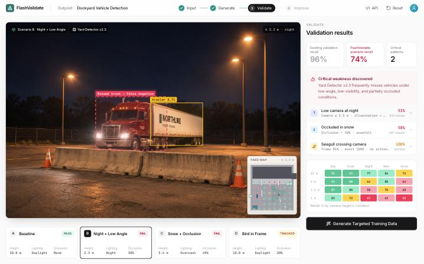

# FlashValidate

A side project I built for fun, after reading the [FlashWorld](https://arxiv.org/abs/2510.13678) paper on generating 3D scenes in seconds. I wondered what you could build on top of it, and landed on this: an imagined tool that turns a few labeled camera images into explorable 3D environments, finds where a computer vision model fails, and generates labeled training data to fix it.



> **This is a just-for-fun interactive mock-up, not a working product.** No machine learning runs. Every model result, metric and customer detail is invented. "Outpost" is used as an example customer only; this project is not affiliated with or endorsed by any company of that name, and nothing here describes a real company's systems or performance. See [What's real and what's simulated](#whats-real-and-whats-simulated).

## Prerequisites

| You need | Details |
|---|---|
| **Node.js** | Version **20.19 or later** in the 20.x line, or **22.12 or later**. npm comes with it. Check with `node -v`. Get it from [nodejs.org](https://nodejs.org) (the LTS version is fine). |
| **Git** | To clone the repo. Check with `git --version`. |
| **A desktop browser with WebGL** | Tested in Chromium-based browsers (Chrome). Hardware acceleration must be on, which is the default. |
| **A window about 1440 × 900 or larger** | The layout is designed for a laptop or desktop screen, not a phone. |
| **About 500 MB of free disk space** | For the repo and its dependencies. |

You do **not** need a GPU, an API key, an account, Python, or a backend. An internet connection is only needed for the install; the app itself runs offline.

Tested on macOS (Apple Silicon) with Node 22. Windows and Linux should work, but haven't been tested.

## Install and run

**1. Clone the repo and go into it**

```bash
git clone https://github.com/reubenmc/flashvalidate-prototype.git
```

```bash
cd flashvalidate-prototype
```

**2. Install dependencies** (about a minute)

```bash
npm install
```

**3. Start the app**

```bash
npm run dev
```

**4. Open it.** Go to **http://localhost:5173** in your browser. The browser doesn't open by itself. If that port is taken, the terminal prints a different URL; use that one.

The first load takes a few seconds. To stop the app, press `Ctrl+C` in the terminal.

### Troubleshooting

| Problem | Fix |
|---|---|
| `npm install` or `npm run dev` complains about the Node version | Upgrade Node to one of the versions above. |
| `npm: command not found` | Node isn't installed, or your terminal needs restarting after installing it. |
| The 3D view is blank or black | Turn on hardware acceleration in your browser settings, then reload. |
| The first run of the demo stutters | The browser is preparing the 3D scene. Run through once, click **Reset**, then go again. |

### Optional: run a production build

```bash
npm run build
```

```bash
npm run preview
```

Then open the URL it prints (by default http://localhost:4173).

## What to click

1. **Input:** The Outpost project opens with the model's 96% recall and the CAM-03 image, with detections drawn on it.
2. **Generate:** *Generate Test Environments* lifts the image into a 3D point cloud, then into an explorable yard. Drag to orbit, scroll to zoom, or pick scenario A, B or C. The camera flies through the same environment, and labels follow every object.
3. **Plan:** *Plan Validation* shows the scenario plan: what FlashValidate will test and why (gaps in the customer's data, their deployment profile, production logs). Toggle rows, or type your own scenario. Try *"A seagull flies in front of the camera"*: it's interpreted as a scene object, a 3D seagull is inserted in front of CAM-03, and Scenario D appears.
4. **Validate:** *Run Model Validation* runs a 2,400-view sweep. Recall drops from 96% to 74%, the yard map lights up where the model fails, and the view lands on the missed truck. Click the scenarios, failure patterns or map pins to inspect the other results.
   If the seagull was added, Scenario D shows frame-level vs. event-level scoring: the truck is missed for 2 of 14 frames while the gull crosses, but tracking re-acquires it, so it's marked TRACKED rather than FAIL.
5. **Improve:** *Generate Targeted Training Data* produces 1,000 labeled images (a 6-image sample is shown). *Export Training Dataset* downloads a real `.zip`.
6. **Reset** (top right) restarts the demo. **API** opens the API / MCP view.

## What's real and what's simulated

It's a mock-up, so no machine learning runs.

| Part | How it works |
|---|---|
| 3D dockyard | A real-time 3D scene (React Three Fiber) built procedurally in code: warehouse, trucks, trailers, lighting, night and snow. It stands in for a FlashWorld-generated Gaussian-splat environment. |
| "Generation" | A scripted animation. Points are sampled from the scene's surfaces, start on the source image plane, and lift to their 3D positions. The "8.2 s" figure is illustrative. |
| Photoreal views | `public/photos/*.png` are AI-generated images, made by restyling renders of the same 3D scene (see `image-briefs/PROMPTS.md`). They are not real camera footage. Scenario D is Scenario A with a generated gull composited in. Any photo that's missing falls back to the live 3D render. |
| Labels / bounding boxes | **Real geometry.** In the 3D view, boxes are each object's 3D bounds projected through the current camera, so they follow you as you orbit. On the photoreal images they are hand-fitted. |
| Scenario plan | Rows and reasons are prepared data. Typed scenarios are matched by keyword (bird/seagull → scene object with a working Scenario D; forklift/person → scene object; lens/rain-drop → sensor; fog/storm → weather). Only the seagull has a full 3D + results path. |
| Seagull (Scenario D) | A real 3D object placed 6 m in front of CAM-03. Its projected box shows exactly what it hides. Results (2 of 14 frames missed, tracked) are hardcoded. |
| Model detections and validation | **Hardcoded.** Pass/fail per scenario, confidences, the 96% → 74% recall, the heatmap, sweep map and failure patterns all come from `src/data/results.ts`. |
| Training data | Six example images with hand-fitted labels. "1,000 images" and the 400/400/200 split are illustrative. |
| Export | **Real file.** A `.zip` built in the browser with the 6 images, COCO-format `annotations.json`, `manifest.csv` and a README. |
| API / MCP | A design mock-up. There is no backend or API. |

## Project structure

```
src/
  App.tsx                 layout shell
  store.ts                app state (zustand)
  lib/flow.ts             stage orchestration (generate → validate → improve)
  lib/exportDataset.ts    zip / COCO / CSV export
  data/scenarios.ts       camera presets + conditions for scenarios A–D
  data/plan.ts            scenario plan rows + typed-scenario matching
  data/results.ts         prepared detections, metrics, heatmap, patterns
  data/shots.ts           every still image (camera pose + brief)
  data/photos.ts          photo detection + fitted bounding boxes
  scene/                  3D yard, vehicles, lighting/weather, camera rig,
                          seagull, label projection, point-cloud effect
  ui/                     top bar, viewport stage, overlays, minimap,
                          scenario plan, panels
  dev/GuideExporter.tsx   dev-only: renders guide images (open /?guides)
image-briefs/             guide renders + prompts for the photoreal images
public/photos/            photoreal images used by the demo
```

## Updating the photoreal images

1. Follow `image-briefs/PROMPTS.md` to generate an image from its guide render.
2. Save it as `public/photos/<shot-id>.png` (or `.jpg`).
3. The app picks it up on reload. Re-fit the boxes in `src/data/photos.ts` (`FITTED`) if objects moved.

To re-render the guides after changing the scene, run `npm run dev` and open http://localhost:5173/?guides. Files are written to `image-briefs/`.
